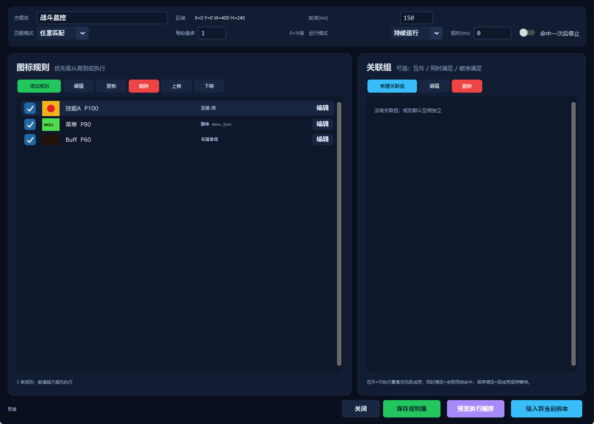
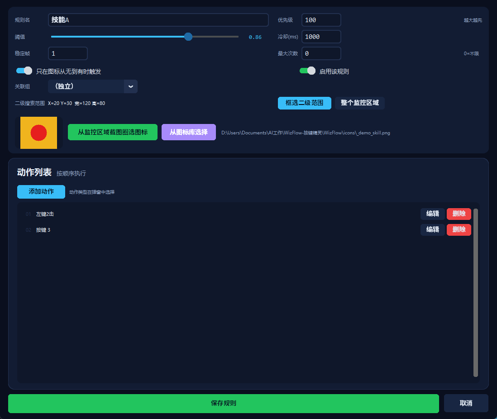
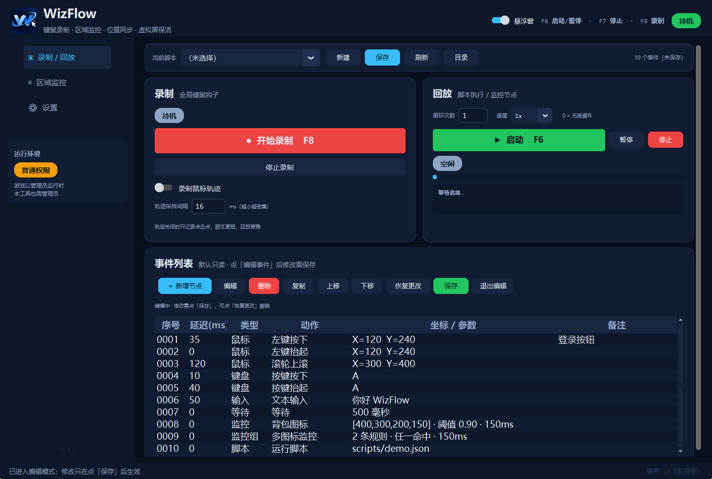
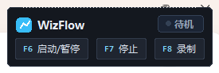

<p align="center">
  
</p>

<h1 align="center">WizFlow</h1>

<p align="center">
  Windows 工作流自动化 · 键鼠录制 · 区域监控 · 图案触发 · 虚拟屏保活
</p>

<p align="center">
  
  
  
</p>

---

WizFlow 是一个面向 Windows 的工作流自动化工具，用来把**高频、重复、规则固定**的操作变成可回放的脚本：键鼠点击、滚轮、键盘输入、等待、窗口切换、表单填报、数据录入、批量修改、审批/登记、跨软件搬运数据等，都可以录一次、反复执行。

它也可以盯着屏幕上的某个图标或图案：图案出现时自动点击、按键、滚动或调用子脚本，适合“等某个状态出现再继续”的流程。除了办公与业务系统，同一套能力也可以用于模拟器/游戏日常任务、软件测试和固定流程演示。

项目使用 Python + CustomTkinter 编写，脚本、截图和配置都保存在本机，界面和逻辑完全本地运行，不需要浏览器插件，也不依赖云端账号。虚拟屏保活自带 Parsec VDD 签名驱动，首次启用时安装一次即可。

### 适用场景

- **办公 / 业务系统**：ERP、CRM、OA、工单、后台管理里的登记、修改、审核、查询、批量录入
- **表单与数据搬运**：网页/桌面软件之间复制字段、逐条填报、批量核对
- **重复巡检**：定时查看某个界面状态，出现指定图标/提示时执行对应操作
- **测试与演示**：固定步骤回归、重复点击、流程演示
- **模拟器 / 游戏**：日常任务、界面监控、图案出现后自动操作
- **个人自动化**：把“打开软件 → 输入 → 等待 → 点击 → 关闭”串成一条脚本

WizFlow 的定位不是替代业务系统，而是把其中**重复度最高、最容易出错的那几步**自动化，让人把时间放在判断和异常处理上。

## 功能

- **键鼠录制 / 回放**：记录点击、滚轮、键盘输入，支持循环、速度调整、全局热键。
- **录制轨迹开关**：开启后记录鼠标移动采样点；关闭后只记录点击点，脚本更短。
- **监控场景**：一个抓屏源 + 场景区域 + 轮询间隔；所有规则共用这一帧画面，支持多显示器、窗口抓屏。
- **多监控方案库**：保存多套命名方案（场景、规则、关联组），支持新建、复制、改名、删除、导入、导出、一键切换。
- **窗口抓屏**：可直接绑定 MuMu / 雷电 / 普通桌面窗口，使用 Windows Graphics Capture 抓取被遮挡窗口，另有 GDI PrintWindow 兜底；区域坐标相对窗口客户区，窗口移动后点击仍然准确。
- **区域截图内圈选图标**：先截取监控区域，再在截图里缩放、平移、拖拽裁剪模板。
- **监控规则**：每条规则独立图标、二级 ROI、阈值、优先级、常驻开关；支持冷却、稳定帧、最大触发次数。
- **规则导入 / 导出**：规则和关联组可导出 JSON、导入覆盖或追加，方便跨机器迁移。
- **规则管理**：按名称/图标搜索，支持仅常驻/仅启用筛选、全部常驻/全部取消、双击编辑；每条规则可设置独立轮询间隔。
- **方案整包**：方案导出 zip（scheme.json + icons/），导入自动还原图标。
- **性能统计**：规则状态显示命中分数和单次匹配耗时，场景状态显示抓屏耗时。
- **关联组**：互斥、同时满足、顺序满足。
- **多样化动作**：左键/右键/滚轮/侧键 X1/X2、单击/双击/三击、长按、上/下滚动、移动、拖拽、键盘按键、组合键、输入文本、运行脚本、等待、通知、停止。
- **统一动作**：鼠标操作 / 键盘操作 / 脚本操作；后台规则和脚本节点共用同一套动作编辑器；动作列表支持拖拽排序。
- **命中后动作**：鼠标键支持左键、右键、滚轮、侧键 X1/X2；滚轮支持上滚动、下滚动、格数与间隔；位置支持图标中心、固定位置（屏幕取点）、偏移跟随、随机偏移。
- **位置同步**：点击跟随图标当前位置；子脚本可按锚点整体平移坐标。
- **虚拟屏保活（Parsec VDD）**：内置签名驱动，一键创建真正的虚拟显示器；断开 UU 远控后监控区域仍有画面。首次启用弹一次 UAC。
- **会话保活（内置兜底）**：SetThreadExecutionState 阻止睡眠/熄屏/屏保，空闲时微动鼠标，不依赖驱动。
- **事件列表编辑**：表格展示序号 / 延迟 / 类型 / 动作 / 参数 / 备注；新增、编辑、删除、复制、上移、下移，双击编辑，Delete 删除，Ctrl 多选。
- **监控节点可视化编辑**：脚本里的监控节点可直接双击打开编辑器，在屏幕上重新框选区域、查看区域缩略图、从当前画面圈选图标模板，不必跳回监控页。
- **迷你悬浮窗**：310×88 卡片，右上角常驻，运行状态 + F6/F7/F8 三个键位；可拖动、贴边、调背景透明度、鼠标穿透；文字层独立，调透明度后字体仍然清晰。
- **系统托盘**：点关闭按钮最小化到托盘，不退出；双击托盘图标恢复；托盘右键可显示/隐藏悬浮窗、取消悬浮窗穿透、退出。
- **后台规则**：多图标规则列表，每条规则独立区域 / 模板 / 阈值；命中时运行、暂停、继续、停止当前脚本或指定脚本，消失时可反向恢复；支持优先级、稳定帧、冷却和独立抓屏源。
- **脚本内监控节点分支**：单次判断 / 限时等待 / 一直等待；命中运行子脚本后继续下一步，未命中或超时走另一支；同步嵌套，同一时间只有一条执行流。
- **固定窗口界面**：主窗口固定 1200×860，界面尺寸不可调，保证区域监控、图标库与规则列表完整显示。
- **稳定性**：单实例互斥、热键冲突提示改键、DPI 变化检测、无边框全屏提示、编辑草稿自动保存与崩溃恢复、异常写入 `logs/crash_*.txt`。

## 更新日志

见 [CHANGELOG.md](CHANGELOG.md)。

## 界面截图

| 录制 / 回放 | 区域监控 |
|---|---|
|  |  |

| 多图标规则 | 规则编辑 |
|---|---|
|  |  |

| 区域截图圈选图标 | 框选监控区域 |
|---|---|
|  |  |

| 事件列表编辑 | 迷你悬浮窗 |
|---|---|
|  |  |

## 安装

### 方式一：下载 exe

从 [Releases](https://github.com/WW-Ares/WizFlow/releases) 下载：

- `WizFlow.exe`：单文件版，首次启动约 5–15 秒。
- `WizFlow-win64-1.9.3.zip`：文件夹版，启动更快，需保留 `_internal` 目录。

> 文件夹版不能只拷贝 exe，必须保留整个目录。不要运行 `build/` 下的中间产物。

### 方式二：源码运行

```bat
python -m pip install -r requirements.txt
python main.py
```

或双击 `启动.bat`。

要求：Windows 10/11，Python 3.10+。如果目标游戏以管理员身份运行，WizFlow 也需要右键「以管理员身份运行」，否则 UIPI 会拦截注入的键鼠消息。

## 快速使用

### 1. 录制与回放

1. 打开「录制 / 回放」。
2. 点「开始录制」或按 `F8`。
3. 操作鼠标键盘；需要记录移动轨迹时打开「录制鼠标轨迹」。
4. 再按 `F8` 结束，脚本自动保存到 `scripts/`。
5. 设置循环次数和速度，按 `F6` 启动 / 暂停，`F7` 停止。

`F6` / `F7` / `F8` 可在设置页修改。

### 2. 监控场景与规则

1. 进入「区域监控」，「监控场景」里选择抓屏方式：

   - `屏幕`：原来的 mss 全屏抓取
   - `窗口`：Windows Graphics Capture，可抓被遮挡窗口（推荐模拟器）
   - `窗口(GDI)`：PrintWindow 兜底
3. 选择「窗口」后点「选择窗口」，从列表里选 MuMu / 雷电 / 目标程序。
4. 点「框选区域」，主窗口自动最小化，在窗口客户区内拖拽框选，`Enter` 确定。
5. 区域坐标保存为窗口客户区相对坐标；窗口移动或缩放后仍然有效。
6. 在「监控规则」里新建规则，选择图标、ROI、阈值和动作。

### 3. 抓取图标

1. 框选区域后点「抓取并保存图标」。
2. 在弹出的区域截图中缩放、平移、拖拽圈选图标。
3. 输入文件名保存。模板保存在 `icons/`，后续规则直接引用。

也可以在多图标规则里点「从图标库选择」复用已有模板。

### 4. 多监控方案库

区域监控页顶部「方案」栏：

- 下拉切换已保存的方案
- 新建：创建空白方案
- 复制：复制当前方案
- 改名 / 删除
- 导入 / 导出：方案 JSON 文件，可跨机器迁移
- 每个方案独立保存：捕获方式、窗口绑定、区域、单图标参数、多图标规则和关联组
- 插入脚本的监控节点会带上 `scheme_id` / `scheme_name`，同时内嵌完整参数快照；换机器或方案被删后脚本仍可运行

### 5. 监控规则

1. 区域监控页右侧「监控规则」。
2. 点「+ 新建规则」，选择图标、设置阈值、优先级、冷却、稳定帧。
3. 点「添加动作」，在弹窗里选择鼠标 / 键盘 / 脚本动作并填写参数。
4. 需要关联时，在右侧新建关联组：
   - `互斥`：只执行优先级最高的命中成员；
   - `同时满足`：组内全部同帧命中才执行；
   - `顺序满足`：按成员顺序等待。
5. 点规则行的「插入」，把单条规则快照插入脚本；点「插入整组」插入整个规则组。
6. 点「测试全部」可以先抓一帧，查看每条规则当前得分。

同一帧命中多个图标时默认按 **优先级降序 → 匹配分数降序 → 列表顺序** 执行。

### 6. 命中后动作

单图标「监控参数」支持：

- **鼠标操作**
  - 鼠标键：左键 / 右键 / 滚轮 / 侧键 X1 / 侧键 X2
  - 左键、右键、侧键：单击 / 双击 / 长按
  - 滚轮：单击 / 双击 / 长按（中键行为）+ 上滚动 / 下滚动
  - 上滚动 / 下滚动只出现在滚轮键下；滚动格数 1 格 = 120 单位，可设每格间隔
  - 位置：图标中心 / 固定位置 / 偏移跟随 / 随机偏移
  - 固定位置：点「圈选点击位置」，在屏幕上点一下取点，不填 XY
  - 偏移跟随：图标移动多少，点击位置同步移动多少
  - 单击 / 双击 / 长按、左键/右键/中键/侧键
  - 随机偏移 X/Y：在点击位置附近随机抖动
- **键盘操作**
  - 点「录制按键」后直接按键
  - 支持单键和 `Ctrl` / `Alt` / `Shift` / `Win` 组合键
  - 录制时用低级键盘钩子拦截 `Alt+Tab`、`Win+D`、`Alt+F4` 等系统快捷键，不会切窗口
  - 可设按住时长
- **脚本操作**
  - 选择脚本并填锚点 X/Y
  - 命中后把子脚本的绝对坐标整体平移到当前图标位置

**锚点** = 录制脚本时图标所在的屏幕坐标。留空则按脚本原坐标执行。

### 7. 虚拟屏保活（Parsec VDD）

设置页 →「虚拟屏保活」：

1. 打开「启用虚拟显示器」。
2. 首次使用会弹出 UAC，授权后自动安装 `assets/vdd` 里的签名驱动并创建虚拟屏。
3. 状态显示「虚拟屏运行中 · 当前 1 块」即成功。
4. 关闭开关会停止 50ms 心跳并移除本程序创建的虚拟屏。

适用场景：关闭显示器，或 UU 远控 / ToDesk / 向日葵断开后物理显示器/虚拟屏消失，区域监控抓不到画面。WizFlow 自己挂一块 Parsec 虚拟屏，监控始终有画面。

- 驱动来源：`nomi-san/parsec-vdd` v0.45.1（MIT，已签名），随程序打包。
- 只操作 WizFlow 自己创建的虚拟屏，不影响系统已有显示器。
- 「安装驱动 / 卸载驱动」可手动维护；卸载后该功能不可用。

### 8. 会话保活（内置兜底，无需驱动）

设置页 →「会话保活」：

- `SetThreadExecutionState` 阻止空闲睡眠、熄屏；
- 系统空闲超过 15 秒时微动鼠标 1px 并移回，防止屏保/空闲锁屏；
- 用户正在操作时不动鼠标。

> 两个开关相互独立，可以同时开：虚拟屏负责有画面，会话保活负责系统不休眠。
> 公司组策略强制锁屏、安全桌面无法用普通进程绕过。

### 9. 事件列表编辑（草稿模式）

「录制 / 回放」→「事件列表」默认只读，只有「编辑事件」按钮：

1. 点「编辑事件」进入编辑模式，工具栏出现：新增节点、编辑、删除、复制、上移、下移、恢复更改、保存、退出编辑。
2. 所有增删改都只改草稿，不写文件、不影响回放；回放始终使用上一次保存的版本。
3. 点「保存」才写回脚本并生效；点「恢复更改」丢弃本次全部未保存修改。
4. 点「退出编辑」放弃未保存修改并回到只读模式。
5. 关闭程序或切换脚本时，如有未保存修改会弹窗确认。

- 列：序号、延迟(ms)、类型、动作、坐标 / 参数、备注。
- 双击一行编辑；`Delete` 删除；`Ctrl` 多选后批量删除 / 复制 / 移动。
- 新增节点支持：鼠标点击（单击/按下/抬起）、鼠标移动、滚轮、键盘按键（含组合键录制）、文本输入、等待、监控节点、运行脚本、原始 JSON。
- 监控节点双击打开可视化编辑器：框选区域、区域缩略图、从当前画面圈选模板、图标库下拉。
- 监控组节点双击仍跳到「区域监控」页的多图标规则窗口，避免两处配置不一致。
- 节点可写备注，仅用于列表说明，不影响回放。

### 10. 迷你悬浮窗

主界面右上角「悬浮窗」开关：

- 默认贴在屏幕右上角，卡片 259×76，不进任务栏、不抢焦点。
- 状态胶囊：灰「待机」/ 绿「运行中」/ 黄「已暂停」/ 红「录制中」。
- 一行三个键位：`F6 启动/暂停`、`F7 停止`、`F8 录制`，间距一致，可直接点击。
- 按住卡片可拖动，靠近边缘自动吸附；位置、透明度、穿透状态写入 `config.json`。
- 背景透明度 100/90/80/70/60/50%；卡片背景透明，文字与图标始终 100% 不透明并带深色投影。
- 鼠标穿透后，重新关开悬浮窗会自动取消穿透；也可以从托盘右键菜单「取消悬浮窗鼠标穿透」恢复。
- 右键菜单：打开主界面、鼠标穿透、背景透明度、隐藏悬浮窗。

### 11. 系统托盘

- 点窗口右上角关闭按钮：最小化到托盘，程序继续运行，热键照常生效。
- 双击托盘图标或托盘菜单「显示主界面」恢复窗口。
- 托盘右键菜单：显示主界面、显示/隐藏悬浮窗、取消悬浮窗鼠标穿透、退出 WizFlow。
- 首次隐藏会弹一次托盘气泡提示；如果图标没出现在任务栏右下角，点 `^` 展开隐藏图标区。

### 12. 界面尺寸

- 主窗口固定 1200×860，不提供缩放设置
- 系统 DPI 较高时，由 Windows 统一缩放整个窗口
- 页面内容按固定尺寸排版，避免缩放导致的裁切

### 13. 后台规则（脚本外控制）

区域监控页底部「后台规则」卡片：

1. 「新建规则」或「从当前方案新建」。
2. 编辑规则：名称、启用、优先级、监控区域、图标模板、阈值、稳定帧、冷却、轮询间隔。
3. 「命中时动作」：图案出现时执行。
4. 「消失时动作」：图案消失时执行。
5. 每个动作包含：
   - 操作：运行 / 暂停 / 继续 / 停止
   - 目标：当前脚本 / 指定脚本
   - 脚本（目标为指定脚本时）
   - 忙碌时：切换 / 忽略（仅“运行”）

执行模型：

- 同一时间只有一条执行流；运行另一个脚本会先停止当前脚本（忙碌时选“切换”）。
- 暂停按原因记录：规则只恢复自己暂停的脚本，不会误恢复别的规则或手动暂停。
- 手动 F6 / F7 优先；手动停止后规则不会自动恢复。
- 多条规则同帧命中时按优先级执行；规则组支持互斥 / 并行（预留）。
- 旧版「后台监控」配置启动时自动迁移成一条规则。

示例：

- 规则 A：命中 → 运行 脚本1（忙碌时切换）
- 规则 B：命中 → 暂停 当前脚本；消失 → 继续 当前脚本

### 14. 脚本内监控节点（分支执行）

「录制 / 回放」→「编辑事件」→ 双击监控节点：

1. 执行方式：
   - 单次判断：只抓一帧，立即出结果
   - 限时等待：最多等 N 毫秒
   - 一直等待：等到命中，F7 可中断
2. 命中动作：通常配置“运行子脚本”。子脚本同步执行，完成后继续主脚本下一步。
3. 未命中 / 超时动作：可以为空，也可以停止脚本或运行其他子脚本。
4. 脚本内节点不能暂停 / 继续 / 停止当前脚本（避免自己暂停自己）。
5. 嵌套深度最多 3 层；脚本自引用会自动跳过并记日志。

示例：主脚本第 6 步判断图标 X，命中运行脚本2，脚本2 结束后继续第 7 步；未命中直接进入第 7 步。

## 脚本格式

标准 JSON，同时兼容 KeymouseGo 的 json5 和旧式数组脚本。

### 普通事件

```json
{
  "format": "wizflow/1",
  "scripts": [
    {"type": "event", "event_type": "EM", "delay": 1000,
     "action_type": "mouse left down", "action": [960, 540]},
    {"type": "event", "event_type": "EM", "delay": 40,
     "action_type": "mouse left up", "action": [960, 540]},
    {"type": "event", "event_type": "EK", "delay": 80,
     "action_type": "key down", "action": [65, "a", 0]},
    {"type": "event", "event_type": "EK", "delay": 40,
     "action_type": "key up", "action": [65, "a", 0]}
  ]
}
```

坐标：

- 整数：虚拟屏幕绝对像素；
- `0.0–1.0` 浮点：主屏归一化；
- `"0.052%"` 字符串：百分比；
- `[-1, -1]`：保持当前鼠标位置。

### 多图标监控节点

```json
{
  "type": "monitor_group",
  "region": [1200, 500, 600, 400],
  "poll_ms": 150,
  "match_mode": "any",
  "max_actions_per_tick": 1,
  "run_mode": "continuous",
  "timeout_ms": 0,
  "rules": [
    {
      "id": "r1",
      "name": "技能A",
      "template": "icons/skillA.png",
      "threshold": 0.86,
      "priority": 100,
      "cooldown_ms": 1000,
      "stable_frames": 1,
      "require_absence": true,
      "actions": [
        {"type": "click", "button": "left", "clicks": 2, "hold_ms": 40,
         "interval_ms": 70, "position": "center", "offset": [0, 0]}
      ]
    }
  ],
  "links": []
}
```

动作类型：`click`、`long_press`、`move`、`drag`、`key`、`text`、`script`、`wait`、`notify`、`stop`。

## 构建

```bat
python -m pip install pyinstaller
python build.py          REM 单文件 -> dist\WizFlow.exe
python build.py --dir    REM 文件夹 -> dist\WizFlow\WizFlow.exe
```

`build.py` 会在构建成功后删除 `build\WizFlow\WizFlow.exe` 中间产物，避免误启动。

## 目录

```text
main.py                 入口 / --selftest / --run
config.py               路径与默认配置
core/
  winapi.py             DPI、屏幕、键鼠注入、唤醒锁
  screen.py             桌面抓屏、模板匹配、PNG 读写
  capture.py            屏幕 / WGC 窗口 / GDI 窗口抓取
  recorder.py           pynput 全局录制
  player.py             回放引擎、monitor / monitor_group 节点
  monitor.py            单图标监控
  monitor_rules.py      多图标规则模型与调度引擎
  actions.py            命中动作执行器
  script.py             脚本读写 / 坐标解析
  hotkeys.py            RegisterHotKey 全局热键
  vdisplay.py           内置会话保活
  vdisplay_parsec.py    Parsec VDD 驱动安装 / 虚拟屏开关 / 心跳
app/
  main_window.py        主窗口装配
  page_record.py        录制 / 回放页
  page_monitor.py       区域监控页
  page_settings.py      设置页
  rules_window.py       多图标规则 / 动作 / 关联组
  region_picker.py      全屏框选
  icon_crop_dialog.py   区域截图内圈选图标
  area_select_dialog.py 二级搜索范围框选
  point_picker.py       固定点击位置取点
  key_record_dialog.py  录制单键 / 组合键
  window_picker.py      选择要抓取的窗口
  event_editor.py       新增 / 编辑脚本节点
  hud.py                迷你悬浮窗
tests/
  test_core.py
  test_monitor_group.py
docs/screenshots/        README 截图
assets/vdd/              Parsec VDD 签名驱动 + nefconw（MIT）
icons/                  图标模板
scripts/                录制脚本
```

## 自检与测试

```bat
python main.py --selftest
python tests\test_core.py
python tests\test_monitor_group.py
```

## 已知限制

- 抓屏使用 `mss`（GDI），模拟器/游戏以 OpenGL/DirectX 独占渲染时可能抓到黑屏，需要后续增加窗口抓屏模式。
- 模板匹配是逐帧搜索，区域越大、规则越多、CPU 越高；建议使用二级搜索范围并合理设置轮询间隔。
- `RegisterHotKey` 被其他程序占用时注册会失败，界面会提示。
- 回放会发送真实键鼠事件，脚本中不要包含无法收场的组合。
- 系统策略强制锁屏/安全桌面无法绕过。
- 虚拟屏驱动首次安装需要管理员授权；公司电脑若禁用驱动安装，需要管理员手动放行。
- 部分游戏/模拟器在全屏独占下切换虚拟屏会闪一下，建议用无边框窗口模式。
- 窗口抓屏需要 Windows 10 1903+；窗口最小化时 WGC 不再产生新帧，监控会保持上一状态，不会误判为图案消失。
- 极少数带反作弊/受保护内容的窗口会阻止 WGC，遇到时改用「窗口(GDI)」或「屏幕」模式。

## 贡献者

- **WW-Ares** — 项目发起、需求、测试与发布
- **Codex (OpenAI)** — 架构设计、代码实现、测试与文档

## 许可证

WizFlow 以 **GNU General Public License v2.0** 发布，完整文本见 [LICENSE](LICENSE)。

本项目参考了 [KeymouseGo](https://github.com/taojy123/KeymouseGo) 的录制/回放模型，上游项目同样使用 GPL-2.0。

第三方依赖许可证见 [THIRD_PARTY_LICENSES.md](THIRD_PARTY_LICENSES.md)。

## 致谢

- [KeymouseGo](https://github.com/taojy123/KeymouseGo)
- CustomTkinter
- OpenCV
- pynput
- 所有开源依赖的作者

