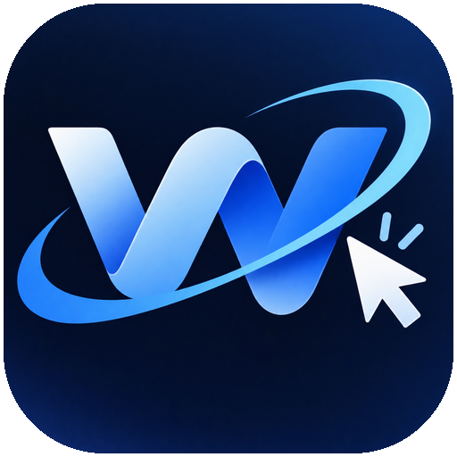
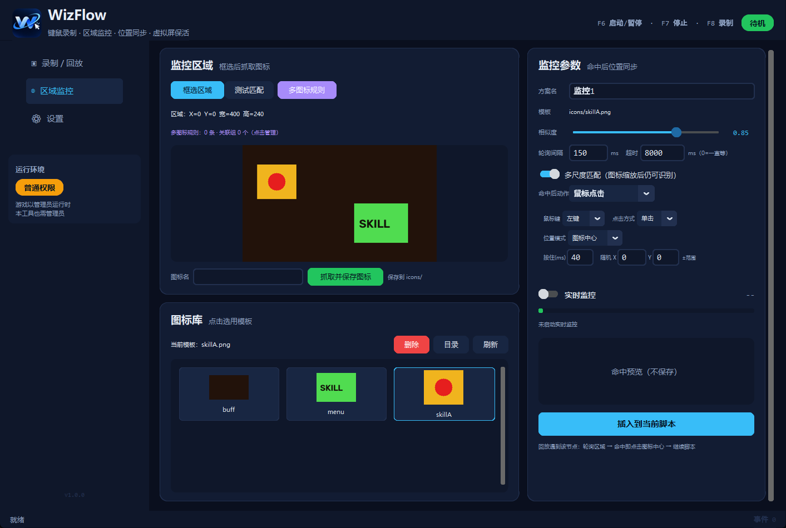
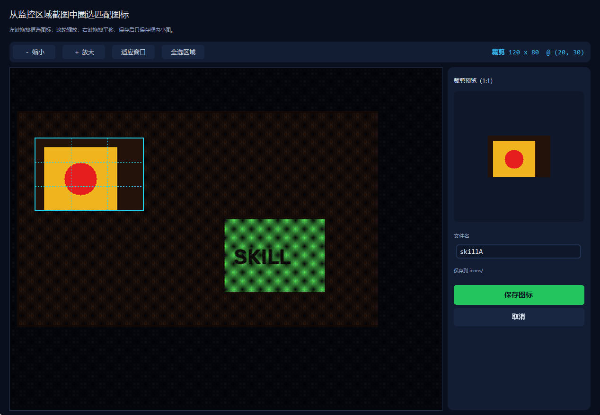
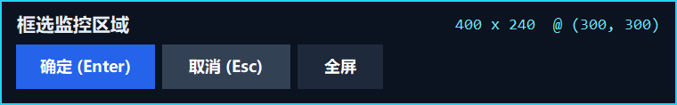

<p align="center">
  
</p>

<h1 align="center">WizFlow</h1>

<p align="center">
  Windows 键鼠录制 · 区域监控 · 多图标规则 · 位置同步 · 虚拟屏保活
</p>

<p align="center">
  
  
  
</p>

---

WizFlow 是一个面向 Windows 的桌面自动化工具：录制鼠标键盘操作并回放，框选屏幕区域做图标匹配，配置多条监控规则，按优先级执行点击、键盘按键或子脚本。

项目使用 Python + CustomTkinter 编写，界面和逻辑完全本地运行，不需要安装浏览器插件、不需要虚拟显示器驱动。

## 功能

- **键鼠录制 / 回放**：记录点击、滚轮、键盘输入，支持循环、速度调整、全局热键。
- **录制轨迹开关**：开启后记录鼠标移动采样点；关闭后只记录点击点，脚本更短。
- **区域监控**：全屏框选监控区域，支持多显示器；框选时主窗口自动最小化。
- **区域截图内圈选图标**：先截取监控区域，再在截图里缩放、平移、拖拽裁剪模板。
- **多图标规则**：同一区域配置多条规则，独立或加入关联组；支持优先级、冷却、稳定帧、最大触发次数。
- **关联组**：互斥、同时满足、顺序满足。
- **多样化动作**：左键/右键/中键/侧键 X1/X2、单击/双击/三击、长按、移动、拖拽、键盘按键、组合键、输入文本、运行脚本、等待、通知、停止。
- **命中后动作**：鼠标点击 / 键盘按键 / 脚本；鼠标支持图标中心、固定位置（屏幕取点）、偏移跟随、随机偏移。
- **位置同步**：点击跟随图标当前位置；子脚本可按锚点整体平移坐标。
- **虚拟屏保活**：内置 Windows API 保活，阻止睡眠/熄屏/屏保，空闲时微动鼠标，不依赖 Parsec 或驱动。
- **响应式界面**：所有页面可滚动，窗口变小不会裁掉控件；支持 100% / 115% / 130% / 150% 界面缩放。

## 界面截图

| 录制 / 回放 | 区域监控 |
|---|---|
|  |  |

| 多图标规则 | 规则编辑 |
|---|---|
|  |  |

| 区域截图圈选图标 | 框选监控区域 |
|---|---|
|  |  |

## 安装

### 方式一：下载 exe

从 [Releases](https://github.com/WW-Ares/WizFlow/releases) 下载：

- `WizFlow.exe`：单文件版，首次启动约 5–15 秒。
- `WizFlow-win64.zip`：文件夹版，启动更快，需保留 `_internal` 目录。

> 文件夹版不能只拷贝 exe，必须保留整个目录。不要运行 `build/` 下的中间产物。

### 方式二：源码运行

```bat
python -m pip install -r requirements.txt
python main.py
```

或双击 `启动.bat`。

要求：Windows 10/11，Python 3.10+。如果目标游戏以管理员身份运行，WizFlow 也需要右键「以管理员身份运行」，否则 UIPI 会拦截注入的键鼠消息。

## 快速使用

### 1. 录制与回放

1. 打开「录制 / 回放」。
2. 点「开始录制」或按 `F8`。
3. 操作鼠标键盘；需要记录移动轨迹时打开「录制鼠标轨迹」。
4. 再按 `F8` 结束，脚本自动保存到 `scripts/`。
5. 设置循环次数和速度，按 `F6` 启动 / 暂停，`F7` 停止。

`F6` / `F7` / `F8` 可在设置页修改。

### 2. 框选监控区域

1. 进入「区域监控」，点「框选区域」。
2. 主窗口自动最小化，拖拽框选目标区域，`Enter` 确定。
3. 框选完成后窗口自动恢复。

### 3. 抓取图标

1. 框选区域后点「抓取并保存图标」。
2. 在弹出的区域截图中缩放、平移、拖拽圈选图标。
3. 输入文件名保存。模板保存在 `icons/`，后续规则直接引用。

也可以在多图标规则里点「从图标库选择」复用已有模板。

### 4. 多图标规则

1. 区域监控页点「多图标规则」。
2. 点「添加规则」，选择图标、设置阈值、优先级、冷却、稳定帧。
3. 点「添加动作」，在弹窗里选择动作类型并填写参数。
4. 需要关联时，在右侧新建关联组：
   - `互斥`：只执行优先级最高的命中成员；
   - `同时满足`：组内全部同帧命中才执行；
   - `顺序满足`：按成员顺序等待。
5. 点「预览执行顺序」可以先抓一帧，查看本轮会执行哪些规则、顺序如何。
6. 点「插入到当前脚本」，回放时遇到该节点会持续监控并执行动作。

同一帧命中多个图标时默认按 **优先级降序 → 匹配分数降序 → 列表顺序** 执行。

### 5. 命中后动作

单图标「监控参数」支持：

- **鼠标点击**
  - 图标中心
  - 固定位置：点「圈选点击位置」，在屏幕上点一下取点，不填 XY
  - 偏移跟随：图标移动多少，点击位置同步移动多少
  - 单击 / 双击 / 长按、左键/右键/中键/侧键
  - 随机偏移 X/Y：在点击位置附近随机抖动
- **键盘按键**
  - 点「录制按键」后直接按键
  - 支持单键和 `Ctrl` / `Alt` / `Shift` / `Win` 组合键
  - 可设按住时长
- **脚本**
  - 选择脚本并填锚点 X/Y
  - 命中后把子脚本的绝对坐标整体平移到当前图标位置

**锚点** = 录制脚本时图标所在的屏幕坐标。留空则按脚本原坐标执行。

### 6. 虚拟屏保活

设置页打开「启用虚拟屏保活」：

- `SetThreadExecutionState` 阻止空闲睡眠、熄屏；
- 系统空闲超过 15 秒时微动鼠标 1px 并移回，防止屏保/空闲锁屏；
- 用户正在操作时不动鼠标；
- 不需要 Parsec VDD、不需要任何额外驱动。

> 公司组策略强制锁屏、安全桌面无法用普通进程绕过。

### 7. 界面缩放

设置页 →「界面」：

- 100% / 115% / 130% / 150%
- 点「保存并重启」生效
- 所有页面支持垂直滚动，窗口高度降低不会裁掉输入框

## 脚本格式

标准 JSON，同时兼容 KeymouseGo 的 json5 和旧式数组脚本。

### 普通事件

```json
{
  "format": "wizflow/1",
  "scripts": [
    {"type": "event", "event_type": "EM", "delay": 1000,
     "action_type": "mouse left down", "action": [960, 540]},
    {"type": "event", "event_type": "EM", "delay": 40,
     "action_type": "mouse left up", "action": [960, 540]},
    {"type": "event", "event_type": "EK", "delay": 80,
     "action_type": "key down", "action": [65, "a", 0]},
    {"type": "event", "event_type": "EK", "delay": 40,
     "action_type": "key up", "action": [65, "a", 0]}
  ]
}
```

坐标：

- 整数：虚拟屏幕绝对像素；
- `0.0–1.0` 浮点：主屏归一化；
- `"0.052%"` 字符串：百分比；
- `[-1, -1]`：保持当前鼠标位置。

### 多图标监控节点

```json
{
  "type": "monitor_group",
  "region": [1200, 500, 600, 400],
  "poll_ms": 150,
  "match_mode": "any",
  "max_actions_per_tick": 1,
  "run_mode": "continuous",
  "timeout_ms": 0,
  "rules": [
    {
      "id": "r1",
      "name": "技能A",
      "template": "icons/skillA.png",
      "threshold": 0.86,
      "priority": 100,
      "cooldown_ms": 1000,
      "stable_frames": 1,
      "require_absence": true,
      "actions": [
        {"type": "click", "button": "left", "clicks": 2, "hold_ms": 40,
         "interval_ms": 70, "position": "center", "offset": [0, 0]}
      ]
    }
  ],
  "links": []
}
```

动作类型：`click`、`long_press`、`move`、`drag`、`key`、`text`、`script`、`wait`、`notify`、`stop`。

## 构建

```bat
python -m pip install pyinstaller
python build.py          REM 单文件 -> dist\WizFlow.exe
python build.py --dir    REM 文件夹 -> dist\WizFlow\WizFlow.exe
```

`build.py` 会在构建成功后删除 `build\WizFlow\WizFlow.exe` 中间产物，避免误启动。

## 目录

```text
main.py                 入口 / --selftest / --run
config.py               路径与默认配置
core/
  winapi.py             DPI、屏幕、键鼠注入、唤醒锁
  screen.py             抓屏、模板匹配、PNG 读写
  recorder.py           pynput 全局录制
  player.py             回放引擎、monitor / monitor_group 节点
  monitor.py            单图标监控
  monitor_rules.py      多图标规则模型与调度引擎
  actions.py            命中动作执行器
  script.py             脚本读写 / 坐标解析
  hotkeys.py            RegisterHotKey 全局热键
  vdisplay.py           内置会话保活
app/
  main_window.py        主窗口装配
  page_record.py        录制 / 回放页
  page_monitor.py       区域监控页
  page_settings.py      设置页
  rules_window.py       多图标规则 / 动作 / 关联组
  region_picker.py      全屏框选
  icon_crop_dialog.py   区域截图内圈选图标
  area_select_dialog.py 二级搜索范围框选
  point_picker.py       固定点击位置取点
  key_record_dialog.py  录制单键 / 组合键
tests/
  test_core.py
  test_monitor_group.py
docs/screenshots/        README 截图
icons/                  图标模板
scripts/                录制脚本
```

## 自检与测试

```bat
python main.py --selftest
python tests\test_core.py
python tests\test_monitor_group.py
```

## 已知限制

- 抓屏使用 `mss`（GDI），模拟器/游戏以 OpenGL/DirectX 独占渲染时可能抓到黑屏，需要后续增加窗口抓屏模式。
- 模板匹配是逐帧搜索，区域越大、规则越多、CPU 越高；建议使用二级搜索范围并合理设置轮询间隔。
- `RegisterHotKey` 被其他程序占用时注册会失败，界面会提示。
- 回放会发送真实键鼠事件，脚本中不要包含无法收场的组合。
- 系统策略强制锁屏/安全桌面无法绕过。

## 贡献者

- **WW-Ares** — 项目发起、需求、测试与发布
- **Codex (OpenAI)** — 架构设计、代码实现、测试与文档

## 许可证

WizFlow 以 **GNU General Public License v2.0** 发布，完整文本见 [LICENSE](LICENSE)。

本项目参考了 [KeymouseGo](https://github.com/taojy123/KeymouseGo) 的录制/回放模型，上游项目同样使用 GPL-2.0。

第三方依赖许可证见 [THIRD_PARTY_LICENSES.md](THIRD_PARTY_LICENSES.md)。

## 致谢

- [KeymouseGo](https://github.com/taojy123/KeymouseGo)
- CustomTkinter
- OpenCV
- pynput
- 所有开源依赖的作者
